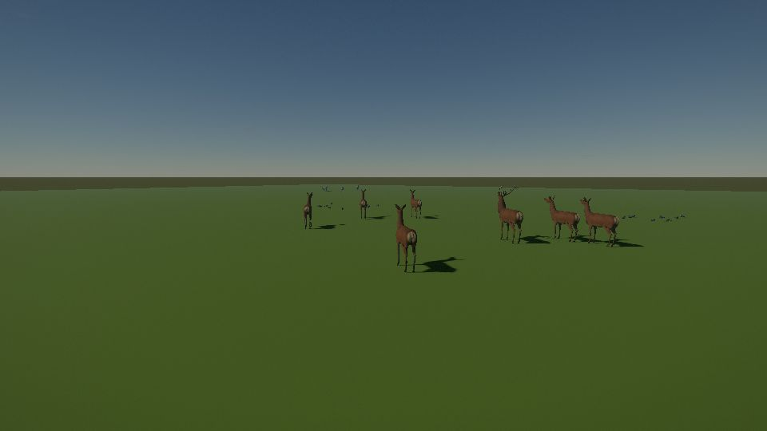

# Red deer

```infobox
image: creatures/red-deer.jpg
caption: A stag in profile, antlers up.
summary: Shy grazers that move in herds and bolt at the first sign of danger.
status: draft
Type: Beast
Habitat: Meadows and open woodland
Behaviour: Skittish, herds
Danger: 1/5
Found on: [Home world](../world/planets/home-world.md)
## Combat
Level: 2 to 6
Health: 50 to 120
Damage: 6 to 14 (stags in the rut)
## Rewards
XP: 10 to 40
Drops: Hide, antlers, venison
```

The **red deer** grazes the meadows and open woods in herds. Stags carry wide antlers; hinds
lead the herd.

## Behaviour

Deer graze, drink at streams and bed down in the grass to rest. The herd keeps watch together:
when one deer stops and raises its head, the others soon do too. At a sound or a scent they
bolt as one, the hinds galloping away while a stag may stand a moment longer.

## Stats

| Kind | Level | Health | Poise | Damage | XP |
|---|---|---|---|---|---|
| Hind | 2 | 50 | 20 | — | 10 |
| Stag | 4 | 90 | 50 | 8 to 12 (antlers) | 25 |
| Stag in the rut | 6 | 120 | 70 | 10 to 14 | 40 |

## Strategy

Approach from downwind and keep low. Wolves hunt deer too, so a herd that suddenly bolts may be
running from something else.

## Locations

- [The Valley](../world/regions/the-valley.md): the meadows.
- [The Bell Foothills](../world/regions/the-bell-foothills.md), [the Tollands](../world/regions/the-tollands.md), [the Pilgrim Hills](../world/regions/the-pilgrim-hills.md), [the Canopy Marches](../world/regions/the-canopy-marches.md) and [the Mirewood](../world/regions/the-mirewood.md)

## Gallery


