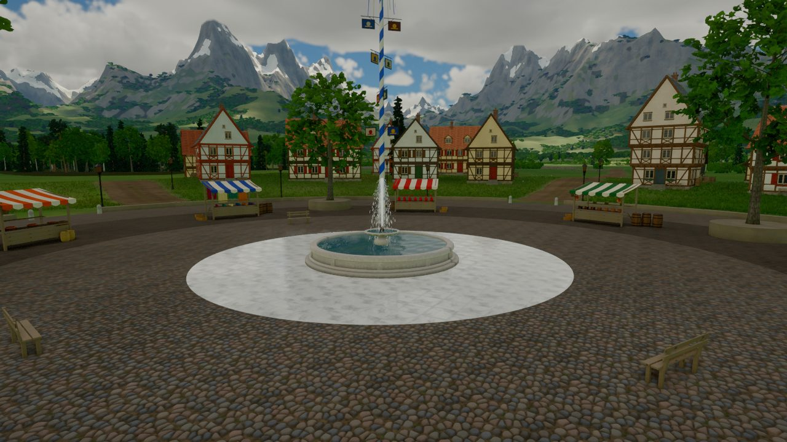

<div class="wiki-hero">

<div class="wiki-hero-text">
<p class="wiki-hero-title">Player Wiki</p>
<p class="wiki-hero-sub">The world, its cities and creatures, its magic, and the machines that carry you between the stars.</p>
</div>
</div>

Start as an ordinary person who has trouble with a house rat. Grow, level by level, past every
limit a mortal has, and ascend until you can stand against the gods themselves. This wiki is
your guide to the world you will cross on the way.

<p class="wiki-eyebrow">Explore</p>

```cards
world/index.md
cities/index.md
creatures/index.md
factions/index.md
magic/index.md
play/combat.md
vehicles/index.md
lore/timeline.md
```

## New here?

- [Getting started](play/getting-started.md): your first hour.
- [Controls](play/controls.md): every key in one place.
- [Movement](play/movement.md): running on walls, slowing time.
- [Progression](play/progression.md): from a rat to the gods.

## About this wiki

The game is still being made, and this wiki grows with it. Pages marked
<span class="wiki-badge wiki-badge-draft">Draft</span> were written from early design notes,
so names and numbers may still change. Pages marked
<span class="wiki-badge wiki-badge-stub">Stub</span> are only a start. Pictures come from the
game's current test builds.

Want to help? [How to add a page](editing/how-to-add-a-page.md) takes two minutes, from a
phone or a computer.
