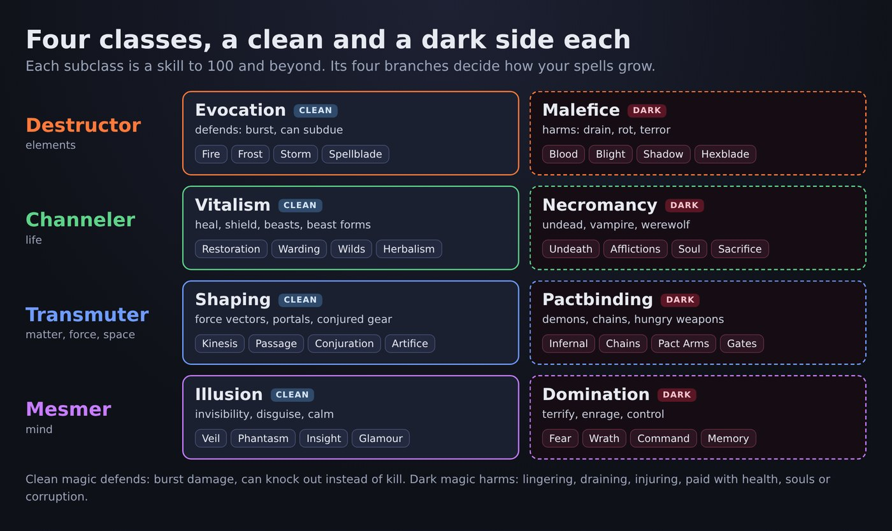

# Classes and subclasses

```meta
image: magic/classes-diagram.jpg
summary: Destructor, Channeler, Transmuter and Mesmer: eight subclasses and thirty-two branches.
```

{{draft}}

There are four classes of magic. Each has a clean and a dark **subclass**, and each subclass
is a skill you level by using it, up to 100 and then beyond. Every subclass has four
**branches**; the branch you choose decides how your spells grow.



| Class | Clean subclass and branches | Dark subclass and branches |
|---|---|---|
| **Destructor** (elements) | **[Evocation](evocation.md)**: Fire, Frost, Storm, Spellblade | **[Malefice](malefice.md)**: Blood, Blight, Shadow, Hexblade |
| **Channeler** (life) | **[Vitalism](vitalism.md)**: Restoration, Warding, Wilds, Herbalism | **[Necromancy](necromancy.md)**: Undeath, Afflictions, Soul, Sacrifice |
| **Transmuter** (matter, force, space) | **[Shaping](shaping.md)**: Kinesis, Passage, Conjuration, Artifice | **[Pactbinding](pactbinding.md)**: Infernal, Chains, Pact Arms, Gates |
| **Mesmer** (mind) | **[Illusion](illusion.md)**: Veil, Phantasm, Insight, Glamour | **[Domination](domination.md)**: Fear, Wrath, Command, Memory |

## Every family, on both sides

| Family | Clean | Dark |
|---|---|---|
| Damage | Fire, Frost, Storm (Evocation) | Blood, Blight, Shadow (Malefice) |
| Force and movement | Force vectors, telekinesis, blink, portals, flight (Shaping) | Crushing chains, shadow step, hellgates, demon wings (Pactbinding) |
| Conjured creatures | Beasts, treants, spirits (Vitalism); elementals (Evocation); constructs (Shaping) | Undead (Necromancy); demons (Pactbinding) |
| Conjured weapons and armour | Arcane blades, bows, shields, force armour (Shaping) | Pact weapons that drink life, hellplate (Pactbinding); bone blades (Necromancy) |
| Healing and buffs | Heal, regrow limbs, revive, shields, wards (Vitalism) | Drain to heal, blood shields, cheat death, bloodlust (Necromancy) |
| Stealth | Invisibility, shroud, silent step, decoys (Illusion) | Witnesses forget (Domination); shadow step (Pactbinding) |
| Social | Calm, inspire, persuade, truth sense (Illusion) | Enrage, terrify, compel, false memories (Domination) |
| Shapeshifting | Disguise (Illusion); beast forms (Vitalism) | Vampirism, lycanthropy (Necromancy); demon form (Pactbinding) |

## Playstyles

| Playstyle | Built from |
|---|---|
| Spell caster | Evocation or Malefice |
| Spellblade | Evocation (Spellblade) and Shaping; dark: Malefice (Hexblade) and Pact Arms |
| Tank mage | Vitalism (Warding) and Shaping |
| Healer | Vitalism (Restoration, Warding) |
| Summoner | Vitalism, Evocation or Shaping; dark: Pactbinding |
| Necromancer | Necromancy, often with Malefice |
| Assassin | Illusion (Veil) and Malefice (Shadow, Blood) |
| Thief | Illusion (Veil, Phantasm) and Shaping (Kinesis) |
| Druid | Vitalism (Wilds) and Evocation (Storm) |
| Warlock | Pactbinding, often with Malefice |
| Herbalist | Vitalism (Herbalism) and the Alchemy profession |
| Artificer | Shaping (Artifice) and the Enchanting and Smithing professions |

## The eight subclasses

Each subclass has its own page, with its lore, its four branches and the named spells of each
branch from Novice to God.

{{cards}}
