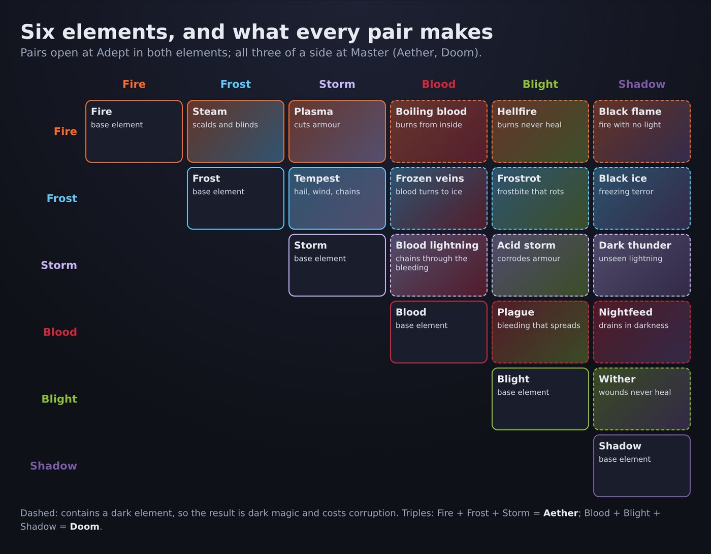
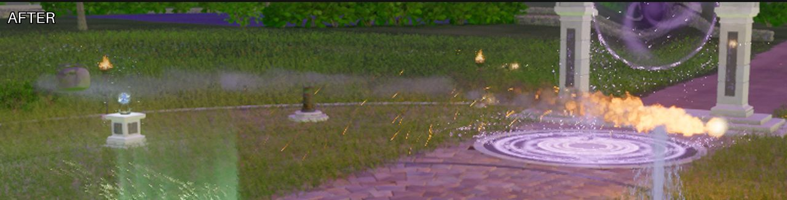

# Elements and combinations

```meta
image: magic/element-combos-diagram.jpg
summary: Fire, Frost and Storm; Blood, Blight and Shadow; and what every pair of them makes.
```

{{draft}}

There are six elements: three clean, three dark. Each has its own feel, and pairs of elements
combine into new ones.



## The six elements

| Element | Side | What it does |
|---|---|---|
| **Fire** | Clean | Burns and spreads |
| **Frost** | Clean | Slows, and builds up to a freeze |
| **Storm** | Clean | Stuns and chains between targets |
| **Blood** | Dark | Drains and bleeds |
| **Blight** | Dark | Rots, poisons and blocks healing |
| **Shadow** | Dark | Terrifies, blinds and eats light |

## Combinations

A pair of elements opens at **Adept** in both; all three of one side at **Master**.

| Combination | Makes | What it does |
|---|---|---|
| Fire + Frost | **Steam** | Scalding clouds that burn and blind |
| Fire + Storm | **Plasma** | A white-hot charge that cuts armour |
| Frost + Storm | **Tempest** | Hail, wind and lightning; slows and chains |
| Fire + Frost + Storm | **Aether** | Shifts between all three and hits whatever a target is weakest to |
| Blood + Blight | **Plague** | Infectious bleeding that spreads to the next body |
| Blood + Shadow | **Nightfeed** | Drains life from anything standing in darkness, unseen |
| Blight + Shadow | **Wither** | Ages flesh; the wound cannot be healed |
| Blood + Blight + Shadow | **Doom** | A curse that does all three and leaps to a new host when its victim dies |

## Clean and dark together

Mixing a clean element with a dark one makes a dark spell, and costs corruption.

| | Blood | Blight | Shadow |
|---|---|---|---|
| **Fire** | Boiling blood | Hellfire: burns that never heal | Black flame: fire that gives no light |
| **Frost** | Frozen veins | Frostrot: frostbite that rots | Black ice: a freezing, terrifying dark |
| **Storm** | Blood lightning: chains through everyone bleeding | Acid storm | Dark thunder: lightning nobody sees coming |

## Elements with everything else

Elements mix with every other kind of magic: Fire with an upward force is a rocket jump, Frost
with water walking leaves a path of ice behind you, Storm on a conjured blade makes a lightning
sword.


