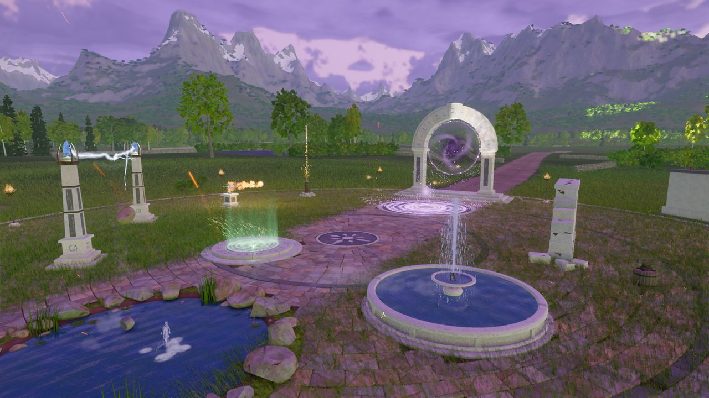

# Magic

```meta
image: magic/spell-court.jpg
summary: Four classes with a clean and a dark side each, six elements, and spells you build yourself.
```

{{draft}}

Magic comes in four classes, and every class has a **clean** side and a **dark** side. You
don't pick spells from a list: you build them from effects, cast types and modifiers, and they
grow with your mastery from a spark to a sun.



## The three rules

1. **Every kind of magic has a clean and a dark version.** Damage, movement, conjuring,
   healing, stealth, social magic and shapeshifting all exist on both sides.
2. **Clean magic defends; dark magic harms.** Clean damage stops a threat fast and can knock
   out instead of kill. Dark magic makes its victim suffer: it lingers, drains, injures and
   stops healing.
3. **Every spell is crafted the same way**: an effect, a cast type, modifiers and power, within
   what your mastery allows. Anything with a dark ingredient is dark.

## Clean and dark

| | Clean | Dark |
|---|---|---|
| Paid with | Mana | Mana plus health, blood, a corpse, a soul or corruption |
| Power for the mana | Normal | About one and a half times |
| Damage | Burst; stops attackers; can subdue | Lingering suffering, drain, injuries, no healing |
| Bystanders | Easy to protect | Splash by default; protecting them costs extra |
| The law | Legal almost everywhere | A crime if witnessed in most places |

## Corruption

Dark magic leaves a mark. **Corruption** builds with every dark spell and shows on your body: in
your veins, your eyes, your voice. People and factions treat you differently, temples and some
towns close their doors, and at its peak a dark god takes notice. Healing magic and shrines can
cleanse it.

## Learn more

{{cards}}
