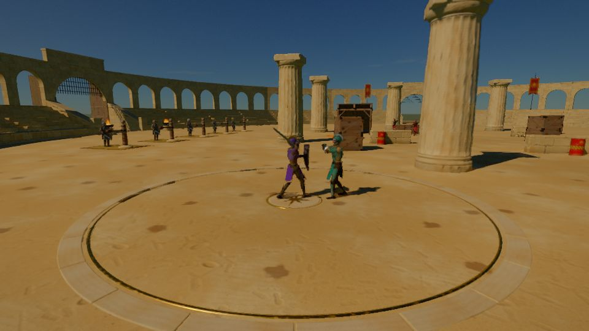

# Combat

```meta
image: play/arena-duel.jpg
summary: Aim where you look, chain strikes from every angle, parry at the last moment and finish in slow motion. Every blow lands somewhere on the body, and where it lands matters.
```

{{draft}}

Combat is fast and physical: chain attacks into combos, parry at the last moment, break an
opponent's guard, and finish the fight in slow motion. Every blow lands somewhere on the body,
and where it lands matters. You aim with your eyes: whatever part of your enemy you are looking at
is what you try to hit.



## Attacking and defending

- **Light and heavy attacks** chain together. Each strike in a chain comes from a new angle, so
  pressing the same button doesn't make the same swing: a slash, a backhand, a rising cut, a
  thrust.
- **Cancels**: you can cancel out of one move into the next, or into a dodge, inside a short window
  after each strike lands.
- **Stabs**: when an opening appears (a raised arm, a turned back, a staggered foe), your next
  strike becomes a thrust into the gap.
- **Guard**: block high, middle or low, in the line the blow is coming from. Blocking costs
  stamina; heavy blows cost poise as well.
- **Parry**: block at the last moment to throw the attack aside and leave your opponent open. The
  window grows with your weapon skill.
- **Guard break**: a heavy enough attack, or a Crush weapon, breaks a block.
- **Feints**: start an attack and change it before it lands. Opponents feint too, more on the
  harder [difficulties](difficulty.md).
- **Dodge**: step, roll or slide out of the way, in [slow motion](movement.md#focus-slowing-time) if
  your reflexes are good enough.
- **Finishers and kill cams**: a staggered or badly hurt enemy can be finished with a move of its
  own for each weapon, and the last blow of a fight can play out in slow motion.

## Aiming at the body

Look at a knee and you cut at the knee, or the hamstring if you are behind. Look at an arm and you
cut the arm. Look at the neck and you go for the head. Look at the body and you hit the body. The
part you are aiming at is outlined faintly as you look.

- **Vital parts are guarded.** People protect their heads and necks first, and their bodies next,
  so aiming there is harder. A skilled opponent guards better.
- **Your weapon skill decides how often you hit** what you aim at. At Novice your blows go roughly
  where you meant; at Master they go exactly there.
- **Approach matters.** From the front a knee cut buckles the leg; from behind it hamstrings. A stab
  to the back of the belly is a kidney strike.
- **What you hit decides what happens**: disarm a weapon arm, cripple a leg, blind with a head
  blow, sever a limb with a strong clean cut. See [Damage, armour and injuries](injuries.md).

## Loadouts

What you hold in each hand changes how you fight. Your moves change with your **loadout**:

| Loadout | How it fights |
|---|---|
| **One weapon, empty off hand** | Fast and free, grabs and shoves with the other hand |
| **Weapon and shield** | Bash, block without parrying, guard allies, push through a line |
| **Two weapons** | Its own chains of strikes with both blades; no blocking with a shield |
| **Two-handed weapon** | Wide, heavy swings that break guards and knock people down |
| **Weapon and spell** | Cast with the off hand between strikes (see [Spellblade](../magic/evocation.md#spellblade)) |
| **Weapon and torch** | Light, fire on every off-hand swing, and animals that keep their distance |
| **Bow** | Draw, hold and loose; aim sway falls with Perception and Bows skill |
| **Firearm** | Carbines and rifles, held in both hands, slow to reload, loud, and banned without a licence in most cities |
| **Empty hands** | Unarmed: punches, kicks, throws and grapples |

## Weapons

| Weapon | Damage | Speed | Reach | Good at |
|---|---|---|---|---|
| **One-handed blades** | Cut, Pierce | Fast | Medium | Everything, nothing best |
| **Daggers** | Pierce | Very fast | Short | Stabs, gaps in armour, killing unseen |
| **Axes** | Cut | Medium | Medium | Hooking shields, cutting limbs |
| **Maces** | Crush | Medium | Short | Armour, bones, poise |
| **Spears** | Pierce | Medium | Long | Keeping enemies away, fighting from behind a shield |
| **Two-handed blades** | Cut, Pierce | Slow | Long | Wide arcs, half-swording against armour |
| **Great axes and hammers** | Cut or Crush | Very slow | Long | Breaking guards, knocking down |
| **Shields** | Crush | Medium | Short | Blocking, bashing, guarding others |
| **Bows** | Pierce | Draw time | Very long | Quiet killing at range |
| **Firearms** | Pierce | Slow to reload | Very long | Punching through armour and thin walls |

Weapons are held by a hand: lose the use of one and you fight with the other, less skilfully unless
you trained your **Off hand** skill. Full tables of weapons, materials and their numbers are on
[Weapons](../items/weapons.md).

## Stamina and poise

Every swing, block and dodge costs **stamina**. When it runs out you can't block or dodge, and your
swings slow down. Every hit you take, and every heavy blow you block, costs **poise**; when poise
runs out you **stagger**, wide open to a finisher. Enemies work the same way: a fight is as much
about wearing down their stamina and poise as their health. See
[Attributes and vitals](attributes.md#vitals).

## Fighting groups

Enemies don't all attack at once, but they don't wait politely either. On Medium two will fight you
at a time; on Very hard three, with archers volleying from behind. Keep your back to a wall,
fight in doorways, use the land: high ground, water that slows, fire that blocks.

## Injuries

Every hit lands on a body part. An arrow in a knee can lock the joint and change how you walk;
a crippled arm can make you drop your weapon. Healing magic, bandages, splints and potions mend
injuries. See [Damage, armour and injuries](injuries.md) and [Status effects](status-effects.md).

## Power you can see

The stronger you are, the more the world reacts to you. An ordinary person's blows touch
nothing but their target. At high levels a missed strike bends the grass; after Awakening it
cracks stone, topples trees and sends out shockwaves. Ascendants fight in a world that bends around
them.

## Fighting styles

- **Tank**: hold attention with taunts, shield-bash enemies down, guard allies, raise walls of
  earth, and turn blocked blows into counter-attacks. A good tank decides where the fight happens.
- **Healer**: brew potions on the spot, heal over time, cleanse injuries (unlocking a locked knee
  mid-fight), grow healing plants where you stand and raise the fallen.
- **Stealth**: stay in shadow, move quietly, wear disguises and take enemies down unseen (see
  [Stealth](stealth.md)).
- **Spellblade**: steel in one hand, magic in the other.
- **Summoner**: fight through beasts, spirits, constructs, the dead or demons.

See also [Magic](../magic/index.md), [Skills](skills.md) and [Progression](progression.md).
