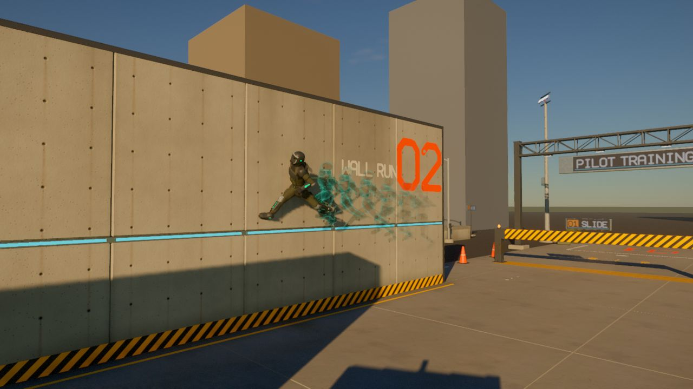
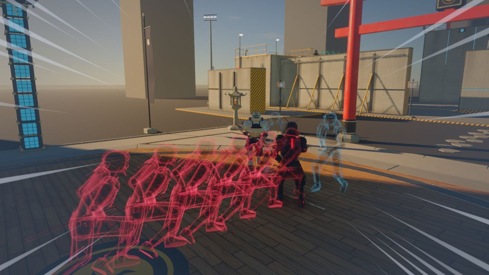
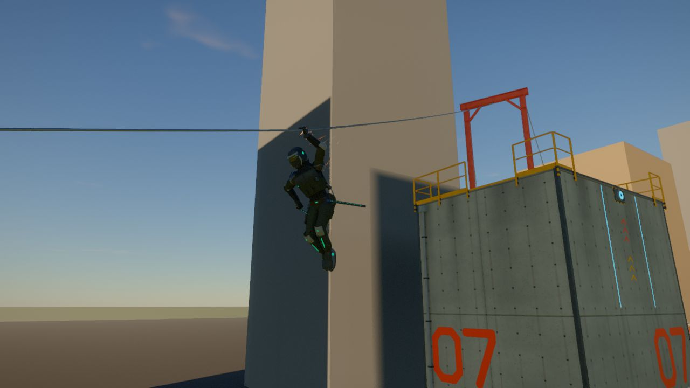

# Movement

```meta
image: play/wall-run.jpg
summary: Run on walls, hang from ledges, ride zip lines and slow time when danger comes.
```

{{draft}}

Movement is fast and acrobatic: you can run along walls, leap between them, climb, hang from
ledges and ride lines strung between rooftops. When danger comes, a trained fighter sees it in
slow motion.



## What you can do

| Move | How it works |
|---|---|
| Wall run | Jump at a wall at speed and run along it |
| Wall jump | Kick off one wall to reach another |
| Double jump | Jump again in mid-air |
| Slide | Drop low at speed to pass under bars and gaps |
| Vault | Hop over low walls and rails without stopping |
| Mantle | Pull yourself up onto a ledge you can reach |
| Ledge hang | Hang from an edge, shimmy along it and around corners |
| Ladders | Climb up and down |
| Zip lines | Jump into a line to catch it and ride it down |
| Grapple | Fire a line to a point and pull yourself to it |
| Moving platforms | Land on a moving freight car and ride it |

## Focus: slowing time

When an attack comes at you, your **reflexes** decide how fast you see it. An untrained person
is cut down before they can react. A trained fighter sees the same attack in slow motion,
steps aside and strikes back while the world crawls. Reflexes grow with your level, and so
does your own speed.



## Where to practise

The movement course in [the Valley](../world/regions/the-valley.md) has walls, towers, ladders,
a freight car and a zip line.


