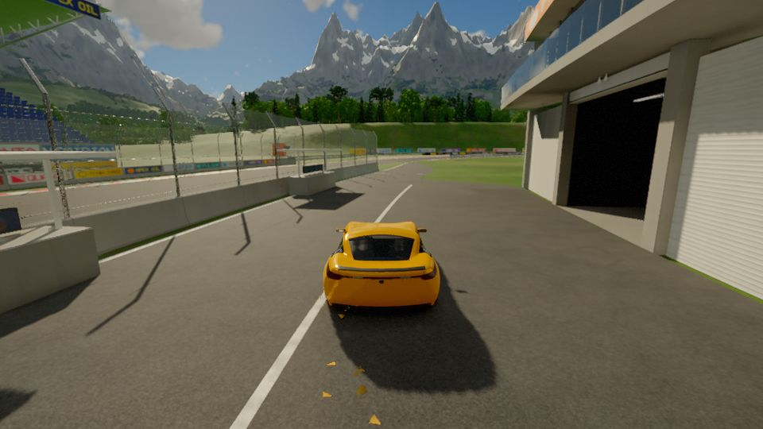

# Cars

```infobox
image: vehicles/sports-car.jpg
caption: A red sports car on the apron.
summary: Fast road cars with real suspension, drifts and jumps; one waits in the pit lane.
status: draft
Type: Car
Seats: 2
Where to find: The race track's pit lane in [the Valley](../world/regions/the-valley.md)
```

**Cars** are driven like the real thing: weight shifts in corners, the tyres slide when you
push too hard, and a crest at speed sends you flying.



## Where to find them

A yellow car is parked in the race track's pit lane, in front of the garages. Any other car
works too, once it has nearly stopped.

## Controls

| Key | Action |
|---|---|
| W | Throttle |
| S | Brake; hold at a stop to reverse |
| A / D | Steer |
| Space | Handbrake |
| Shift | Boost |
| Mouse | Swing the camera; it settles back behind the car |
| Wheel | Zoom |
