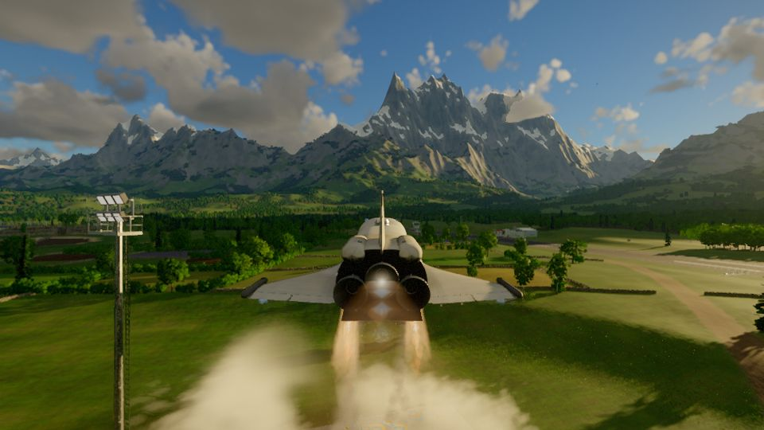
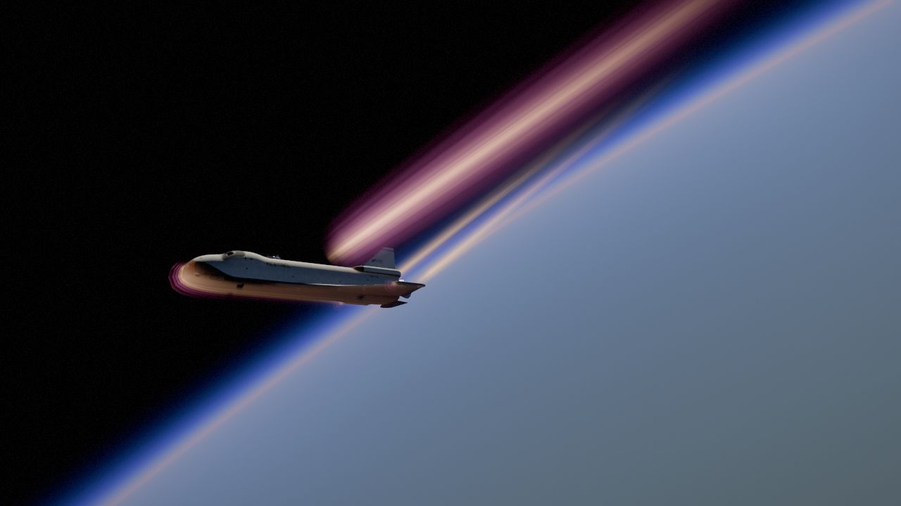

# Spaceships

```infobox
image: vehicles/spaceplane.jpg
caption: The Kestrel spaceplane on the spaceport apron.
summary: Spaceplanes that hover, take off from the pad, fly to orbit and land on other worlds.
status: draft
Type: Spaceplane
Where to find: The spaceport apron in [the Valley](../world/regions/the-valley.md)
```

**Spaceships** hover on their engines, fly like planes in the air, climb to orbit and cross
between planets and stars. Coming home, they glow with the heat of re-entry.



## Where to find them

A spaceplane is parked on the spaceport apron, beside the launch pad.

## Controls

| Key | Action |
|---|---|
| Space / Ctrl | Lift up and down on the hover engines |
| H | Hover assist: holds the ship up |
| W / S | Main engine lever |
| Shift | Full thrust |
| Mouse | Aim |
| A / D | Roll |
| G | Landing gear |
| J | Cruise (see [Star travel](star-travel.md)) |


