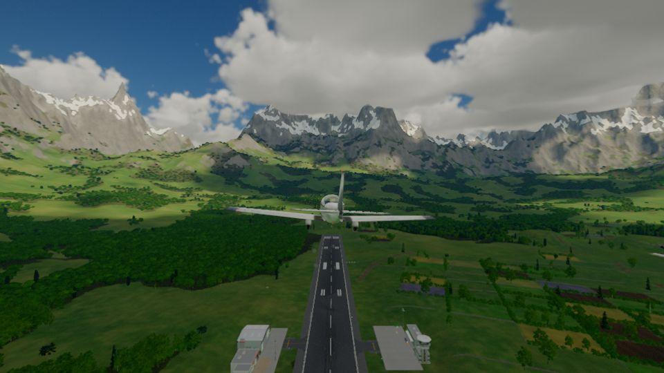

# World and map

```meta
image: world/valley-from-the-air.jpg
summary: Planets, regions and landmarks: where everything is, from one valley to the stars.
```

{{draft}}

The world is not one map but many. You begin in a mountain valley on your home world, and
the same ground stretches unbroken to the horizon, over the oceans and out to orbit. Beyond
it lie the Moon, a red desert planet and the worlds of other stars, each with its own land to
explore.



## The world map

The great continent stretches between two seas, one on the west coast and one on the east, with
snowy mountains and ice floes along the north. At its exact centre stands
[the Gilded Ascent](../cities/gilded-ascent.md), and every major trade road leads there. Around it
the land changes gradually from marsh woodland in the west to desert in the south-east, with a
fertile, Mediterranean coast in the south-east and a great swamp in the south-west. Between the
cities lie long stretches of open country to travel.

The drawn map is coming soon. Until then, this is where the thirteen great cities stand:

| City | Where | Known for |
|---|---|---|
| [The Gilded Ascent](../cities/gilded-ascent.md) | The exact centre | The five-tier market spire where every road meets |
| [Sky City](../cities/sky-city.md) | Centre-east, beside the Gilded Ascent | A floating island of the rich |
| [The Second City](../cities/second-city.md) | North-west coast | A vampire city on the rooftops of a lawful one |
| [Orravell](../cities/orravell.md) | North-west interior | A city in one colossal tree, grown rich on war |
| [Keth Veyra](../cities/keth-veyra.md) | North, in the snowy mountains | Animal keepers and their Brinewings |
| [Oruvai](../cities/oruvai.md) | West, in the marsh woodland | One mind shared by millions of animals and plants |
| [Rillvault](../cities/rillvault.md) | West, toward the centre | An underground breadbasket of glowing tunnel farms |
| [Veyrhold](../cities/veyrhold.md) | East, near the coast | Mages working in a quarry that swallows magic |
| [Vantress](../cities/vantress/index.md) | South-west, in a great swamp by the coast | Floating rafts, moving districts and thieves |
| [Arena City](../cities/arena-city.md) | South, in the middle | A forbidden market by day, an arena by night |
| [Orath](../cities/orath.md) | South-east of the centre | Four faiths sharing one holy spring |
| [Tessara](../cities/tessara.md) | South-east, on a fertile coast | The most advanced city in the world |
| [Sifting Basin](../cities/sifting-basin.md) | South-east, in dry land | Desert wealth sifted from the sand |

## Explore

{{cards}}
