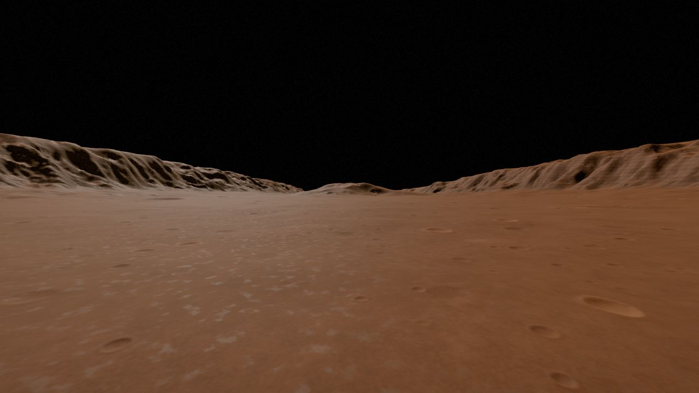

# The red planet

```infobox
image: world/red-planet.jpg
caption: The giant volcano seen from orbit, its summit crater ringed by cliffs.
summary: A cold red desert of giant volcanoes, deep canyons and wind-carved rock towers.
status: draft
Type: Rocky, desert
Star: The Sun
Gravity: About 0.38 g
Atmosphere: Thin, dusty
```

**The red planet** is a cold desert world of rust-red dust, giant volcanoes and canyons deeper
than any on the home world. In the game's test builds it is modelled on Mars.

## Surface

- **The giant volcano**, so wide that its slopes run past the horizon, with a summit crater
  ringed by cliffs.
- **The great canyon**, a rift that cuts across a large part of the planet.
- **The polar caps**, white with ice.
- **Badlands** of [layered buttes](../landmarks/layered-buttes.md),
  [hoodoo fields](../landmarks/hoodoo-fields.md) and [rock arches](../landmarks/window-arches.md).

Dust hangs in the thin air, so the sky glows pale and distant hills fade into haze.



## Getting there

By spaceship and cruise (see [Star travel](../../vehicles/star-travel.md)).
