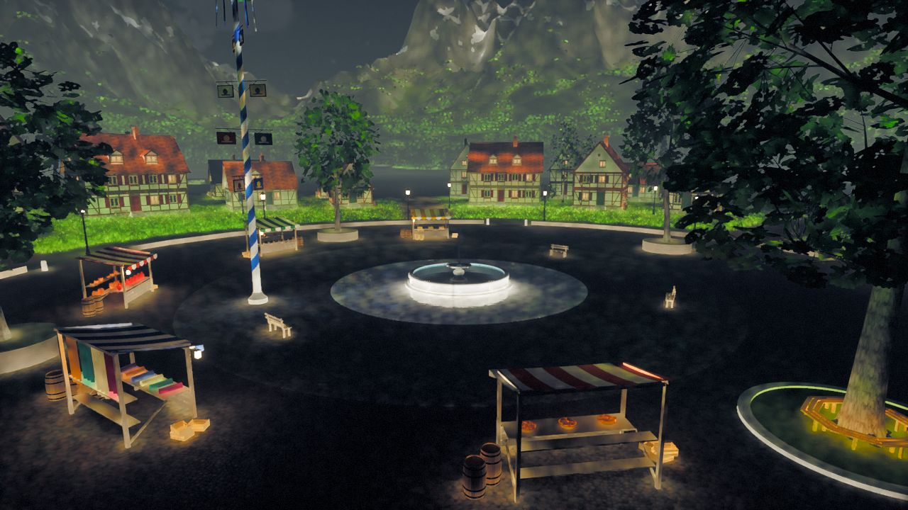

# The Valley

```infobox
image: world/valley-from-the-air.jpg
caption: The Valley from the air, over the airfield runway.
summary: A green mountain valley with a village, a lake, a waterfall, an arena and an airfield.
status: draft
Type: Mountain valley
Planet: [Home world](../planets/home-world.md)
Terrain: Meadows, woods, lake, mountains
Climate: Temperate
Danger: 1/5
```

**The Valley** is a green mountain valley on the [home world](../planets/home-world.md), ringed
by snowy peaks. In the current test builds it is where you start, and almost everything in the
game can be found somewhere in it.

## Getting there

The Valley lies a day's walk west of the Bell Road, up its own river from the caravanserai at
**Halfbell** in [the Bell Foothills](the-bell-foothills.md). The main story begins here, in the
village tavern's cellar (see [A Rat in the Cellar](../../quests/main/a-rat-in-the-cellar.md)).

## Geography

Meadows and woods fill the valley floor, with farmland and roads between them. A stream runs
down to a cliff, falls as a waterfall into a lake and spreads out across a sandy shore.
Mountains rise two to five kilometres out on every side.

## Points of interest

| Place | What is there |
|---|---|
| The village | A cobbled square with a fountain, market stalls and timbered houses |
| [The lake](../landmarks/the-lake.md) | A sandy beach, a wooden jetty and boats |
| [The arena](../landmarks/the-arena.md) | A stone ring where fighters train and duel |
| The airfield | A runway with parked planes |
| The spaceport | A launch pad and a parked spaceplane |
| The race track | A circuit with garages and a pit lane |
| The movement course | Walls, towers, ladders and zip lines for practising [movement](../../play/movement.md) |

## Inhabitants

[Wolves](../../creatures/wolf.md), [red deer](../../creatures/red-deer.md),
[wild boar](../../creatures/wild-boar.md), [rabbits](../../creatures/rabbit.md) and
[starlings](../../creatures/starling.md) live in the meadows and woods; [horses](../../creatures/horse.md)
are kept in the paddock.

## Gallery


